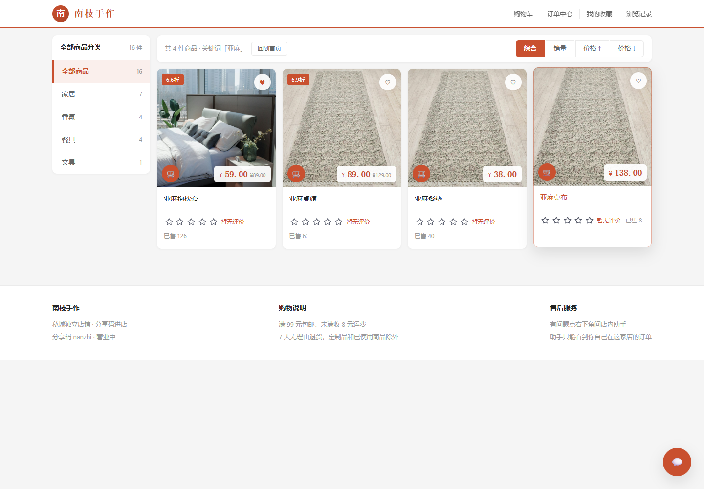
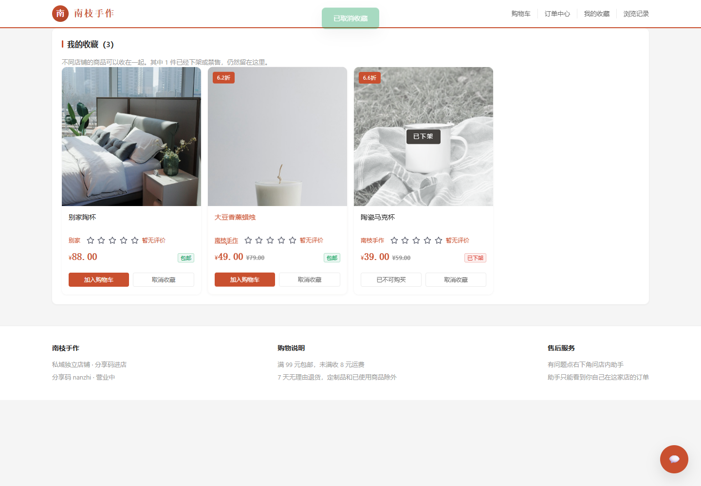
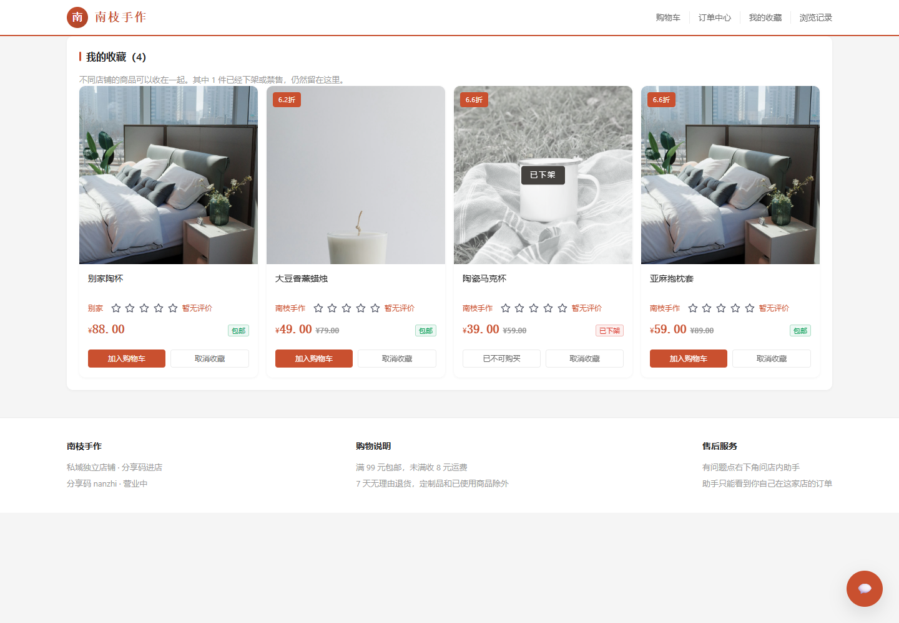
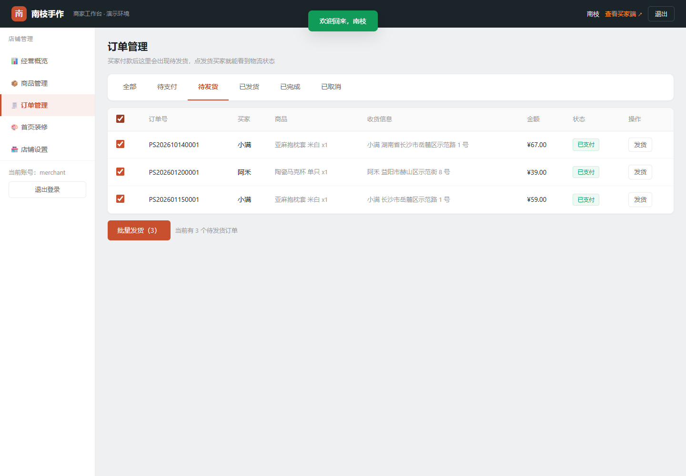

# 私域电商智能运营平台

商家后台和买家店铺读的是同一套店铺、商品和订单。买家只能从分享链接进入对应的那一家店。

## 界面

商品图用的是 Unsplash 的免费照片，已经下载到 `web/covers`，本地跑不依赖外网。
按钮高光、下划线展开、卡片描边这些悬停效果抄自 [Hover.css](https://github.com/IanLunn/Hover)（MIT），只取了用到的几条，没有整份引入。

最上面只有一行：店铺名、购物车、订单中心、我的收藏、浏览记录。


首页从上到下：轮播主视觉 → 店主推荐 → 畅销榜 → 自定义栏目 → 全部商品 → 用户评价 → 售后保障。

**轮播主视觉**：横屏大图，点图直接进对应的商品详情。左右箭头浮在图片两侧、垂直居中，也能点下面的小横条或等它自动走。


**商品栏目**：一行三个，左右箭头同样浮在图片两侧、垂直居中，一次往前翻一张，到头箭头会淡出。推荐位和畅销榜都是这个形式，最多各放 6 件。

**全部商品**：默认给三行（12 件），还有剩下的就出现「展开更多」，点一次再给三行，到底显示「已经到底啦」。搜索框就在这一行标题的右侧。

**用户评价**：两排反向流动的短评，鼠标停上去会暂停。**售后保障**（正品保障、7 天无理由这些）放在页面最后。

### 商品卡

价格在图片右下角，左下角一个小购物车。点购物车会在当前页面弹出小窗，选好 SPU / SKU 后可以直接加购或下单，不会离开首页。


### 搜索与分类

搜索进的是筛选页，左边是分类侧栏，右边可以按销量和价格排序。



### 收藏和浏览记录是跨店铺的

收藏和浏览记录都不分店铺：在哪家店点的心、看过的商品，进的都是同一个列表。列表里每张卡片都标了来自哪家店。




浏览记录只保留最近 7 天看过的商品，同一个商品再看一次会回到最前面。列表右上角可以一键清空。

**下架和禁售的商品不会被删掉**：小店首页和商品详情页不再展示它们，但收藏和浏览记录里仍然保留，卡片会置灰、压上「已下架」「已禁售」的标注，价格还看得见，只是不能加购。



### 商品详情

左边竖向缩略图，右边价格块带划线价和折扣，下面是详情、参数、评价三个页签。


主按钮滚出视野后底部浮出购买栏，规格和价格跟着当前选择走。详情页下方也有同样的推荐位。


### 购物车与订单

购物车支持全选和批量删除，底部结算栏实时算运费；结算页左边填收货信息，右边是订单金额。


待支付订单带倒计时，超过 30 分钟没付款会被定时任务自动取消并把库存退回去。


### 商家后台

工作台样式：顶部深色条、左侧菜单，概览页给四项关键指标，另有最近订单、商品销量排行和库存预警。


**首页装修**分三个页签，买家端首页看到的东西都在这里改：

轮播图可以上传本地图片（也可以填已有路径），设标题、副标题，选跳商品还是跳栏目，还能上移下移调顺序。


商品栏目可以新建、改名、选「手选商品」或「按销量自动取前 6」，手选的可以勾选具体商品。


商品表格带缩略图、库存和低库存提示，上下架、禁售都在行内完成。订单可以按状态筛选、勾选后批量发货。



## 数据怎么连在一起

```text
商家用户 1 —— 1 店铺（分享码）
店铺     1 —— n 商品 SPU
商品     1 —— n SKU
买家用户 1 —— n 订单
订单     n —— 1 店铺
订单     1 —— n 明细
明细     n —— 1 商品 / SKU，并记下当时的名称、规格、单价
```

C 端没有单独的商品副本。商品列表、下单和店内助手都读 `products`、`skus` 这两张表，再用状态决定能不能看、能不能买。

| 状态 | 商家后台 | 买家店铺 | 收藏 / 浏览记录 |
| --- | --- | --- | --- |
| 在售 | 可下架、禁售 | 可见，库存足够就能买 | 正常展示，可加购 |
| 下架 | 可上架、禁售 | 不可见，详情页也打不开 | 保留，标注「已下架」，不能加购 |
| 禁售 | 只能先解禁，回到下架 | 不可见，详情页也打不开 | 保留，标注「已禁售」，不能加购 |
| 店铺停业 | 可改回营业 | 看得到公告，商品列表为空 | 保留，标注「店铺停业」，不能加购 |

收藏和浏览记录按用户存，不分店铺，所以下架的商品不能直接从这两张表里删掉，否则买家会发现收藏莫名少了一件。

买家下单后，订单挂在这家店和这个买家名下，商家后台能看到并发货。之后商家改价或改名，已有订单仍用下单时的快照。

## 本地运行

```powershell
cd Project\private-domain-store-agent\backend
python -m venv .venv
.\.venv\Scripts\pip install -r requirements.txt
.\.venv\Scripts\uvicorn app.main:app --reload
```

打开 [http://127.0.0.1:8000](http://127.0.0.1:8000)。买家端按店铺页来做：搜索（商品名和类目都能搜）、分类筛选、销量/价格排序、规格、购物车、收货地址、满 99 元包邮、待支付/待发货/待收货。商家后台对应管理同一批商品和订单。

- 商家：`merchant` / `merchant123`，后台在 `/b.html`
- 买家：`alice` / `alice123`，进店链接 `/c.html?code=nanzhi`
- 另一位买家：`bob` / `bob123`，用来对照不能看别人的订单

没装 MySQL 和 Redis 时，接口用 SQLite，会话先放在进程内存里。和简历一致的 MySQL + Redis 用项目根目录的 `docker compose up --build`。

Redis 在这套里承担四件事：商品列表缓存、会话上下文、待支付订单的浏览记录，以及结算时的商品热点数据。

店内助手默认走本机 Ollama（`qwen2.5:7b`）。模型没启动时，商品、库存、订单和售后问题会退回规则检索，仍然只查当前这家店。

```powershell
ollama pull qwen2.5:7b
ollama pull nomic-embed-text
```

商家登录后可以调用 `POST /api/v1/b/knowledge/reindex`，把 `backend/knowledge` 里的规则写进 Chroma。向量模型不可用时，售后问答按关键词检索原文。

超时订单由 APScheduler 每 60 秒扫一次，把超过 30 分钟没付款的订单取消并退回库存。定时器起不来时不会影响接口。

## 功能清单

买家端：最上面一行直达购物车 / 订单 / 收藏 / 浏览记录；首页轮播主视觉（点图进详情）、店主推荐 / 畅销榜 / 自定义栏目（一行三个、箭头浮在图片两侧）、全部商品分页展开（默认三行）、用户评价流动展示、页面末尾的售后保障；商品卡图片右下角显示最低价、左下角是小购物车，点开能在当前页面选规格并加购或下单；搜索进筛选页，左边分类侧栏、右边排序；商品详情多图、规格选择、加入购物车、立即购买；收货地址、满 99 元包邮、待支付倒计时、支付 / 取消 / 确认收货；跨店收藏、最近 7 天的浏览记录、商品评价、店内助手多轮对话。

商家后台：经营概览（在售、成交额、待发货、库存预警）、商品销量排行、最近订单、商品上下架 / 禁售 / 解禁、SKU 划线价与库存、每人限购、订单筛选、单个发货、批量发货、店铺 Logo 和主题色，以及首页装修（轮播图上传与排序、栏目位增删改、用户评价维护）。

## 参考了什么

这些功能不是凭空写的，对着同类开源项目抄了做法：

- [imShire/xu-shop](https://github.com/imShire/xu-shop)：单商家私域电商的完整闭环。防超卖的原子扣减、低库存预警、批量发货、下单限购都对着它做。
- [mosliu/ldc-shop](https://github.com/mosliu/ldc-shop)：小店铺的功能清单。多规格、评分评论、公告栏、店铺主题色、订单超时取消从这里补。
- [Web Awesome](https://webawesome.com/)（[Shoelace](https://github.com/shoelace-style/shoelace) 的后继者）：评分和弹层组件，CDN 直接引，不用构建。
- [Hover.css](https://github.com/IanLunn/Hover)：按钮和链接的悬停效果，按它的写法抄进 `web/mall.css`。
- [BpsEason/VueFastMart](https://github.com/BpsEason/VueFastMart)：FastAPI + Vue3 的商城骨架，接口分层参考它。

商品照片来自 [Unsplash](https://unsplash.com/license)，按 Unsplash License 免费使用，下载后放在 `web/covers`，访问外网不是必需的。文件对应关系见 `backend/app/seed.py` 里的 `COVERS`。

## 测试

```powershell
cd Project\private-domain-store-agent\backend
.\.venv\Scripts\pytest
```

覆盖 B / C 两端数据联动、上下架禁售、跨店隔离、订单流转、限购、防超卖、超时取消、批量发货、收藏、浏览记录和评价。

## 目录

```text
backend/app/api/b_api.py           商家后台接口
backend/app/api/c_api.py           买家店铺接口
backend/app/services/home.py       首页轮播、栏目位、用户评价
backend/app/services/shelf.py      上下架、禁售、能不能买
backend/app/services/trade.py      购物车、收货地址、结算
backend/app/services/engagement.py 收藏与浏览记录
backend/app/services/reviews.py    商品评价
backend/app/services/orders.py     下单、支付、发货、超时取消
backend/app/models/tables.py       店铺、商品、SKU、购物车、收藏、评价、订单、轮播、栏目
backend/app/agent/                 只查当前店铺的助手
web/mall.css                       两端共用的样式
web/c.js                           买家店铺
web/b.js                           商家后台
web/covers/                        演示商品图
docs/screenshots/                  界面截图
```
