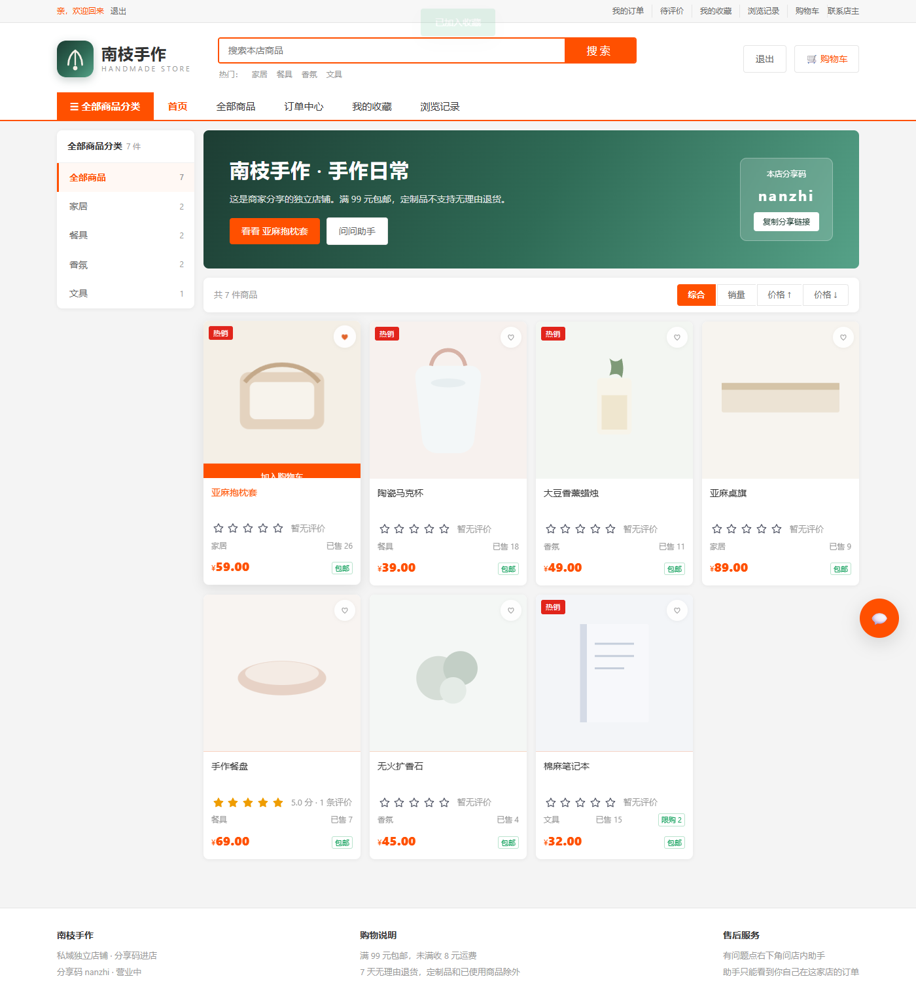
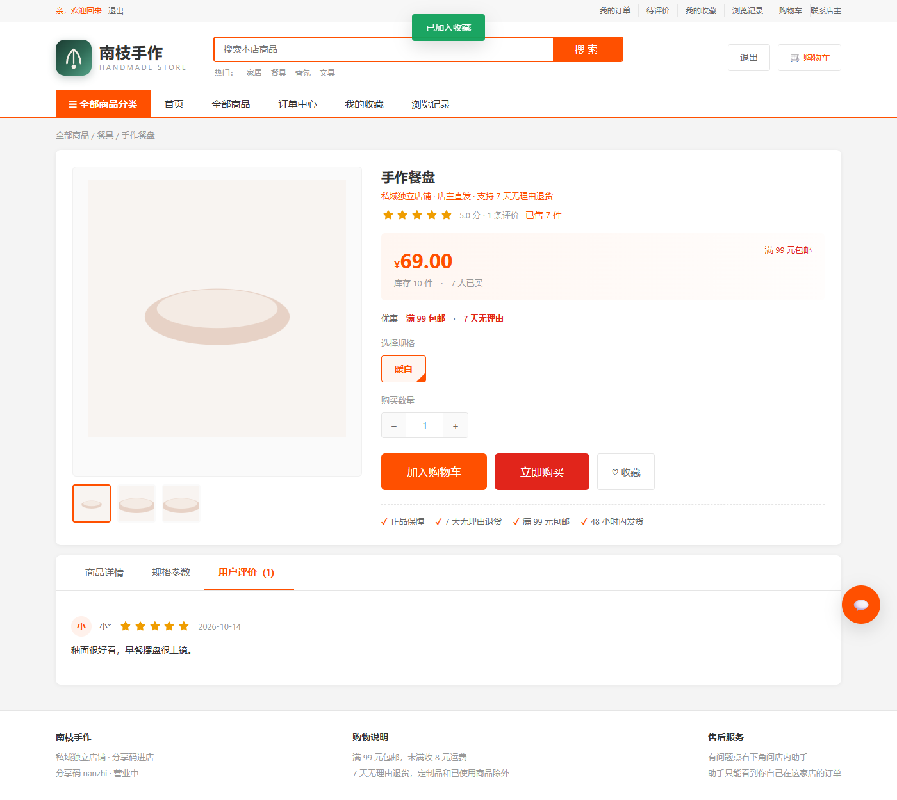
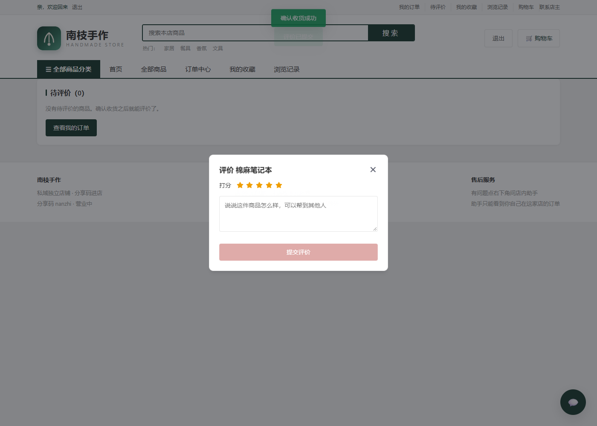
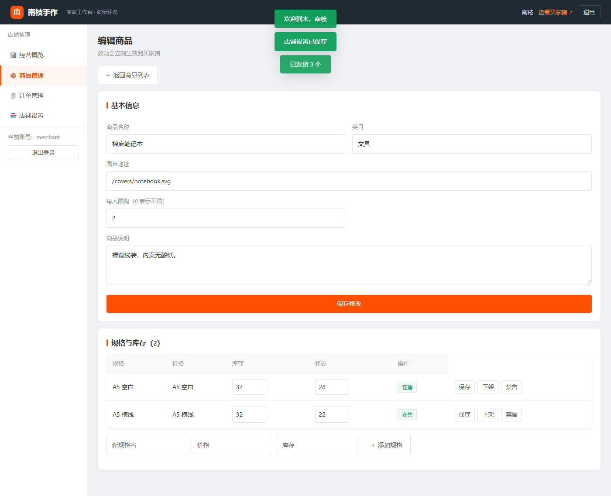

# 私域电商智能运营平台

商家后台和买家店铺读的是同一套店铺、商品和订单。买家只能从分享链接进入对应的那一家店。

## 界面

买家端按店铺页来做：顶部通栏、橙色搜索框加热词、分类导航，左侧是商品分类，右侧是主视觉和商品卡。商品卡上有评分，右上角是收藏心形。


收藏点一下即时生效，收藏过的商品在「我的收藏」里单独一页。




看过什么商品会记进浏览记录，只存在这家店。


详情页左侧是缩略图切换，右侧是价格、优惠、规格和数量，下面有商品详情、规格参数和用户评价三个页签。




确认收货之后就能评价，评分用 Web Awesome 的 `wa-rating`，提交后立刻出现在商品详情里。



购物车支持全选和批量删除，底部结算栏实时算运费；结算页左边填收货信息，右边是订单金额。


待支付订单带倒计时，超过 30 分钟没付款会被定时任务自动取消并把库存退回去。


商家后台是工作台样式：顶部深色条、左侧菜单，概览页给四项关键指标，另有最近订单和库存预警。


店铺设置里可以改店名、公告、Logo 和主题色，主题色会直接用在买家端。


订单可以按状态筛选、勾选后批量发货，被跳过的订单会说明原因。


商品编辑里能设每人限购，也可以直接改规格的价格和库存。



## 数据怎么连在一起

```text
商家用户 1 —— 1 店铺（分享码）
店铺     1 —— n 商品 SPU
商品     1 —— n SKU
买家用户 1 —— n 订单
订单     n —— 1 店铺
订单     1 —— n 明细
明细     n —— 1 商品 / SKU，并记下当时的名称、规格、单价
```

C 端没有单独的商品副本。商品列表、下单和店内助手都读 `products`、`skus` 这两张表，再用状态决定能不能看、能不能买。

| 状态 | 商家后台 | 买家店铺 |
| --- | --- | --- |
| 在售 | 可下架、禁售 | 可见，库存足够就能买 |
| 下架 | 可上架、禁售 | 不可见，也不能买 |
| 禁售 | 只能先解禁，回到下架 | 不可见，也不能买 |
| 店铺停业 | 可改回营业 | 看得到公告，商品列表为空，不能下单 |

买家下单后，订单挂在这家店和这个买家名下，商家后台能看到并发货。之后商家改价或改名，已有订单仍用下单时的快照。

## 本地运行

```powershell
cd Project\private-domain-store-agent\backend
python -m venv .venv
.\.venv\Scripts\pip install -r requirements.txt
.\.venv\Scripts\uvicorn app.main:app --reload
```

打开 [http://127.0.0.1:8000](http://127.0.0.1:8000)。买家端按店铺页来做：搜索（商品名和类目都能搜）、分类筛选、销量/价格排序、规格、购物车、收货地址、满 99 元包邮、待支付/待发货/待收货。商家后台对应管理同一批商品和订单。

- 商家：`merchant` / `merchant123`，后台在 `/b.html`
- 买家：`alice` / `alice123`，进店链接 `/c.html?code=nanzhi`
- 另一位买家：`bob` / `bob123`，用来对照不能看别人的订单

没装 MySQL 和 Redis 时，接口用 SQLite，会话先放在进程内存里。和简历一致的 MySQL + Redis 用项目根目录的 `docker compose up --build`。

Redis 在这套里承担四件事：商品列表缓存、会话上下文、待支付订单的浏览记录，以及结算时的商品热点数据。

店内助手默认走本机 Ollama（`qwen2.5:7b`）。模型没启动时，商品、库存、订单和售后问题会退回规则检索，仍然只查当前这家店。

```powershell
ollama pull qwen2.5:7b
ollama pull nomic-embed-text
```

商家登录后可以调用 `POST /api/v1/b/knowledge/reindex`，把 `backend/knowledge` 里的规则写进 Chroma。向量模型不可用时，售后问答按关键词检索原文。

超时订单由 APScheduler 每 60 秒扫一次，把超过 30 分钟没付款的订单取消并退回库存。定时器起不来时不会影响接口。

## 功能清单

买家端：搜索（商品名和类目）、分类筛选、销量 / 价格排序、商品详情多图、规格选择、加入购物车、立即购买、收货地址、满 99 元包邮、待支付倒计时、支付 / 取消 / 确认收货、收藏、浏览记录、商品评价、店内助手多轮对话。

商家后台：经营概览（在售、成交额、待发货、库存预警）、最近订单、商品上下架 / 禁售 / 解禁、SKU 价格库存、每人限购、订单筛选、单个发货、批量发货、店铺 Logo 和主题色。

## 参考了什么

这些功能不是凭空写的，对着同类开源项目抄了做法：

- [imShire/xu-shop](https://github.com/imShire/xu-shop)：单商家私域电商的完整闭环。防超卖的原子扣减、低库存预警、批量发货、下单限购都对着它做。
- [mosliu/ldc-shop](https://github.com/mosliu/ldc-shop)：小店铺的功能清单。多规格、评分评论、公告栏、店铺主题色、订单超时取消从这里补。
- [Web Awesome](https://webawesome.com/)（[Shoelace](https://github.com/shoelace-style/shoelace) 的后继者）：评分和弹层组件，CDN 直接引，不用构建。
- [BpsEason/VueFastMart](https://github.com/BpsEason/VueFastMart)：FastAPI + Vue3 的商城骨架，接口分层参考它。

## 测试

```powershell
cd Project\private-domain-store-agent\backend
.\.venv\Scripts\pytest
```

覆盖 B / C 两端数据联动、上下架禁售、跨店隔离、订单流转、限购、防超卖、超时取消、批量发货、收藏、浏览记录和评价。

## 目录

```text
backend/app/api/b_api.py           商家后台接口
backend/app/api/c_api.py           买家店铺接口
backend/app/services/shelf.py      上下架、禁售、能不能买
backend/app/services/trade.py      购物车、收货地址、结算
backend/app/services/engagement.py 收藏与浏览记录
backend/app/services/reviews.py    商品评价
backend/app/services/orders.py     下单、支付、发货、超时取消
backend/app/models/tables.py       店铺、商品、SKU、购物车、收藏、评价、订单
backend/app/agent/                 只查当前店铺的助手
web/mall.css                       两端共用的样式
web/c.js                           买家店铺
web/b.js                           商家后台
web/covers/                        演示商品图
docs/screenshots/                  界面截图
```
