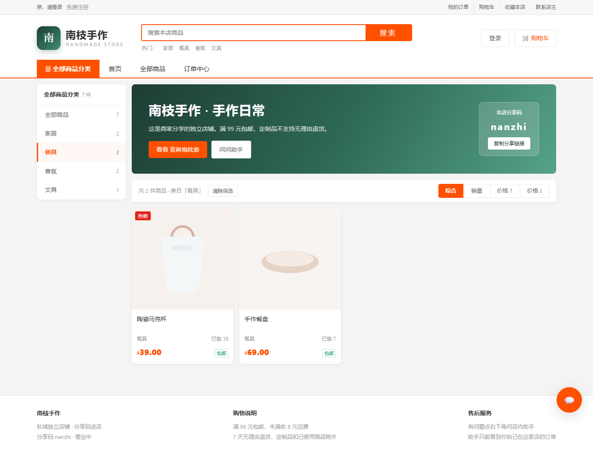
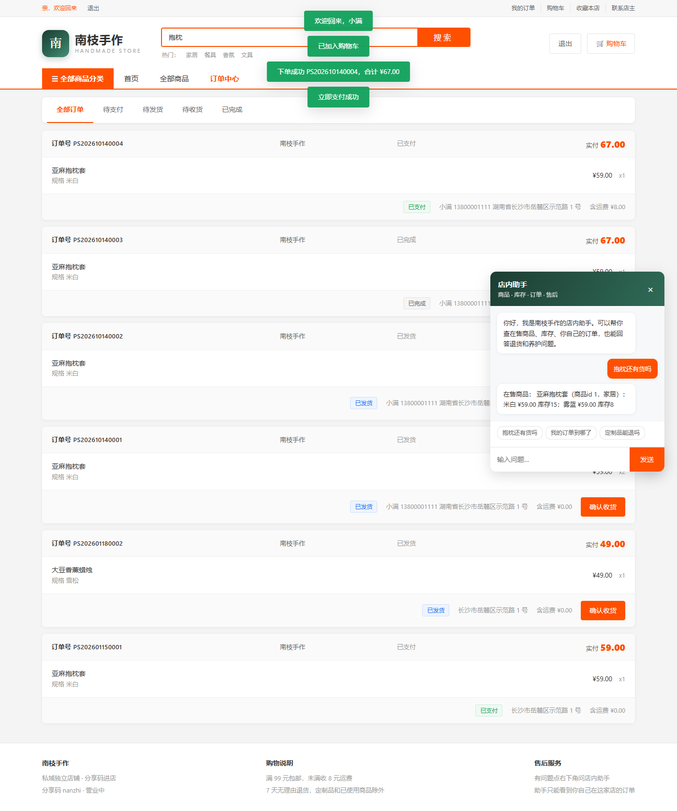
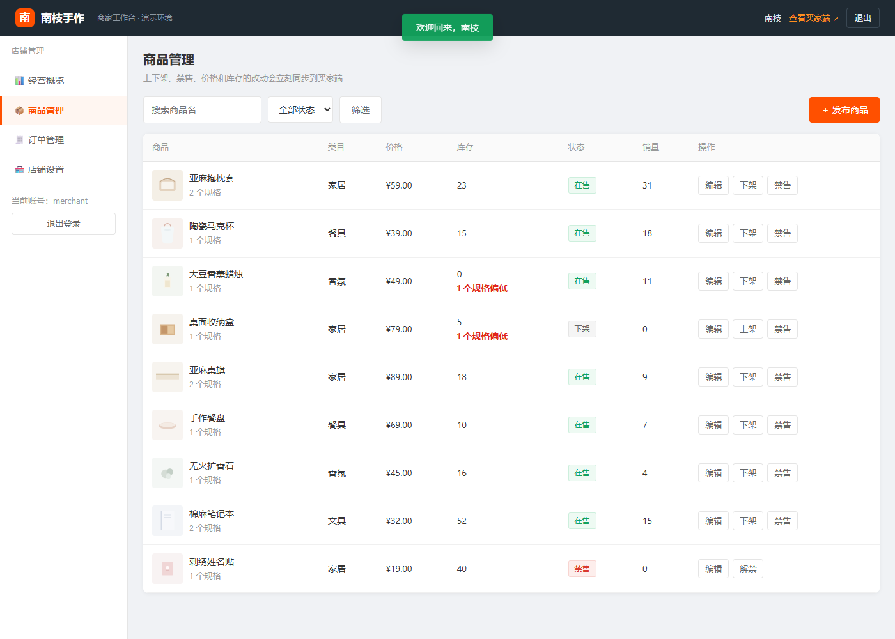
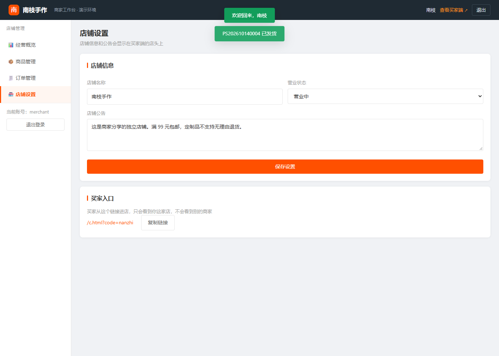

# 私域电商智能运营平台

商家后台和买家店铺读的是同一套店铺、商品和订单。买家只能从分享链接进入对应的那一家店。

## 界面

买家端按店铺页来做：顶部通栏、橙色搜索框加热词、分类导航，左侧是商品分类，右侧是主视觉和商品卡。


分类直接筛选，商品卡右上角标热销，鼠标移上去可以快捷加购。



详情页左侧是缩略图切换，右侧是价格、优惠、规格和数量，下面还有商品详情和规格参数两个页签。


购物车支持全选和批量删除，底部结算栏实时算运费；结算页左边填收货信息，右边是订单金额。


订单按状态分页签，待支付、待发货、待收货各自有对应操作。


店内助手只查当前这家店，订单只能看到自己的。



商家后台是工作台样式：顶部深色条、左侧菜单，概览页给四项关键指标，另有最近订单和库存预警。


商品表格直接显示缩略图、库存和低库存提示，上下架、禁售都在行内完成。



订单可以按状态筛选后一键发货。




## 数据怎么连在一起

```text
商家用户 1 —— 1 店铺（分享码）
店铺     1 —— n 商品 SPU
商品     1 —— n SKU
买家用户 1 —— n 订单
订单     n —— 1 店铺
订单     1 —— n 明细
明细     n —— 1 商品 / SKU，并记下当时的名称、规格、单价
```

C 端没有单独的商品副本。商品列表、下单和店内助手都读 `products`、`skus` 这两张表，再用状态决定能不能看、能不能买。

| 状态 | 商家后台 | 买家店铺 |
| --- | --- | --- |
| 在售 | 可下架、禁售 | 可见，库存足够就能买 |
| 下架 | 可上架、禁售 | 不可见，也不能买 |
| 禁售 | 只能先解禁，回到下架 | 不可见，也不能买 |
| 店铺停业 | 可改回营业 | 看得到公告，商品列表为空，不能下单 |

买家下单后，订单挂在这家店和这个买家名下，商家后台能看到并发货。之后商家改价或改名，已有订单仍用下单时的快照。

## 本地运行

```powershell
cd Project\private-domain-store-agent\backend
python -m venv .venv
.\.venv\Scripts\pip install -r requirements.txt
.\.venv\Scripts\uvicorn app.main:app --reload
```

打开 [http://127.0.0.1:8000](http://127.0.0.1:8000)。买家端按店铺页来做：搜索（商品名和类目都能搜）、分类筛选、销量/价格排序、规格、购物车、收货地址、满 99 元包邮、待支付/待发货/待收货。商家后台对应管理同一批商品和订单。

- 商家：`merchant` / `merchant123`，后台在 `/b.html`
- 买家：`alice` / `alice123`，进店链接 `/c.html?code=nanzhi`
- 另一位买家：`bob` / `bob123`，用来对照不能看别人的订单

没装 MySQL 和 Redis 时，接口用 SQLite，会话先放在进程内存里。和简历一致的 MySQL + Redis 用项目根目录的 `docker compose up --build`。

店内助手默认走本机 Ollama（`qwen2.5:7b`）。模型没启动时，商品、库存、订单和售后问题会退回规则检索，仍然只查当前这家店。

```powershell
ollama pull qwen2.5:7b
ollama pull nomic-embed-text
```

商家登录后可以调用 `POST /api/v1/b/knowledge/reindex`，把 `backend/knowledge` 里的规则写进 Chroma。向量模型不可用时，售后问答按关键词检索原文。

## 测试

```powershell
cd Project\private-domain-store-agent\backend
.\.venv\Scripts\pytest
```

## 目录

```text
backend/app/api/b_api.py      商家后台接口
backend/app/api/c_api.py      买家店铺接口
backend/app/services/shelf.py 上下架、禁售、能不能买
backend/app/services/trade.py 购物车、收货地址、结算
backend/app/models/tables.py  店铺、商品、SKU、购物车、订单
backend/app/agent/            只查当前店铺的助手
web/mall.css                  两端共用的样式
web/c.js                      买家店铺
web/b.js                      商家后台
web/covers/                   演示商品图
docs/screenshots/             界面截图
```
