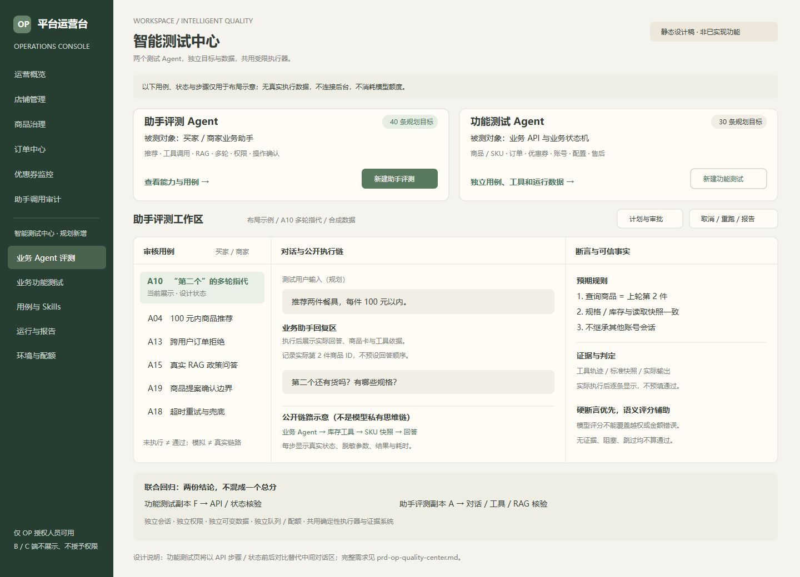

# OP智能测试中心 PRD：双测试Agent与能力可视化

版本：1.0，待用户评审；日期：2026-10-20。  
交付状态：需求文档与静态效果图，不代表功能已实现或已部署。  
关联文档：`prd-test-agent.md`，作为助手评测子模块的详细规范继续使用；冲突处以本总PRD为准。

## 1. 决策与可行性

可以增加业务功能测试，不必牺牲业务Agent评测。但不能将不同目标、数据、工具和判定规则塞进同一个无限权限聊天助手。

采用“一个OP智能测试中心、两个逻辑独立的测试Agent、一套受限执行基础设施”：

- 助手评测Agent（`assistant_eval_agent`）：测试买家/商家业务助手，覆盖回答、工具调用、RAG、多轮与确认操作。
- 功能测试Agent（`functional_test_agent`）：测试商品、订单、优惠券、身份权限等业务API与状态变化，不需要经过业务助手。
- 共用Harness：校验计划、批准、执行调度、断言、预算、证据、报告。它是确定性程序，不是第三个自由决策的测试Agent。
- 业务助手（`business_agent`）：服务B/C用户，是第一个测试Agent的被测对象，不因测试中心加入新工具或更高权限。

这意味着系统在产品逻辑上有“一个业务助手类型＋两个测试Agent类型”。两个测试Agent可以共用模型供应商和部署进程，但不能共享会话状态或无差别工具权限；第一版不需要三个独立模型实例或复杂Agent互相聊天。

本次先确认PRD与视觉结构，不直接创建模型服务、执行真实测试、调用付费模型、授予OP权限或发布。

## 2. 增加功能测试会不会影响原评测

### 2.1 不隔离会出现的问题

- 数据干扰：功能测试将商品下架、耗尽优惠券或扣库存，助手评测按旧事实判断，造成假失败。
- 上下文污染：功能测试指令和业务规则进入助手评测会话，导致规划偏离。
- 权限扩大：允许准备数据/写测试的工具被业务助手或另一测试Agent误调用。
- 资源争抢：功能测试把worker、数据库连接或模型额度占满，助手评测超时。
- 指标混淆：大量容易通过的接口用例稀释Agent失败，显示一个误导性的整体高通过率。
- 结论误归因：底层订单接口坏了，被报告成模型理解失败；或只跑接口就宣称业务助手已通过。

### 2.2 本方案的隔离要求

- 独立目标与提示词：各自固定任务定义、用例类型和工具允许列表。
- 独立会话：`run_id + agent_kind`作用域，不能把另一个Agent历史拼入上下文。
- 独立数据：每个子运行独立fixture和快照克隆，订单、券、Redis会话、Chroma集合均隔离。
- 独立权限：OP能力分别授权；执行器按已批准步骤注入最小测试身份，OP登录权限不能传给被测助手。
- 独立队列与配额：逻辑队列、并发槽位和预算分开，平台总额再加硬上限；不能一个任务无条件占用所有资源。
- 独立报告：两类通过率、覆盖率、真实性和预算各自列示；联合任务显示两张结论，不平均成总分。

即使做到这些，共享MySQL实例、Redis和机器仍可能造成资源竞争，所以不能承诺“绝对零影响”。默认不同数据域；真实模型时延基准、并发/压力测试与稳定回归不同时运行。出现共享资源瓶颈时转为串行或独立worker/依赖实例，报告记录环境竞争，不能修改结果掩盖。

因此本PRD选择新增独立功能测试Agent，而不是扩大助手评测Agent的职责。这里的“新增”是产品设计决定，不代表本轮已经实现。

## 3. 两个测试Agent如何分工

### 3.1 助手评测Agent

入口目标示例：“评测买家助手预算推荐、第二件商品追问、跨用户订单防护，以及商家多SKU草稿提案。”

执行过程：读取审核用例和能力契约 → 生成对话计划 → 模拟测试用户向业务助手发消息 → 收集工具/检索/回答 → 查可信事实 → 固定断言和可选语义评估。

每条业务助手用例必须有被测助手调用及其证据。模拟模型单独标记；只验证API不算完成业务助手评测。此前定义的A01～A40继续适用。

例如“助手说库存10件，但数据是5件”，是助手事实准确性失败。若库存工具自己返回了错误的10件，则保留失败并归因候选为底层工具，不强行说模型幻觉。

### 3.2 功能测试Agent

入口目标示例：“检查优惠券领取、结算锁券、取消释放，以及同SPU跨SKU限购。”

执行过程：读取需求、OpenAPI和已有用例 → 拆解边界与状态机 → 选择审核过的测试模板 → 执行隔离API步骤 → 核验数据库/业务响应 → 形成可复现缺陷。

不要求业务助手参与，不需要RAG或模型回答评分。金额、权限、库存、状态和幂等必须用固定断言。规划可用模型，执行回归无需模型；没有调用规划模型的运行标记为“固定回归”，不伪装成真实Agent规划。

例如“取消订单后库存未回补”，是业务功能失败；无需再通过业务助手问一遍才算发现问题。

### 3.3 共同边界

两者均无任意SQL、Shell、任意URL、自由代码执行、生产写入、自动修复和自动发布权限。AI生成的新测试仅为候选，审核前不能进门禁。业务写测只在已登记隔离环境中执行。

工具动作必须由计划约束，不能通过“请忽略限制”越权。最终通过与否由规则汇总，不由任一模型自行修改。

## 4. OP入口与访问控制

OP侧新增一级分组“智能测试中心”：

- 测试总览：`/op.html#/testing/overview`。
- 业务Agent评测：`/op.html#/testing/assistant`。
- 业务功能测试：`/op.html#/testing/functional`。
- 用例与Skills：`/op.html#/testing/cases`。
- 运行与报告：`/op.html#/testing/runs`。
- 环境与配额：`/op.html#/testing/settings`。

原规划 `/op.html#/agent-testing` 重定向到 `testing/assistant`，保留查询参数和任务ID，不再做第二套页面。

B/C页面、业务助手菜单、普通账号门户不展示入口。手动输入路由、调用API或下载报告也受服务端保护。

现有 `require_operator` 是必要条件，还需分开检查：`qa.view`、`qa.assistant.run`、`qa.functional.run`、`qa.approve`、`qa.environment.manage`。仅有助手评测权限的人不能运行功能测试；联合任务需要两个执行能力。角色不必写进现有业务User.role，可用OP能力记录维护。

模型不能授予这些权限。执行中的OP权限被撤销后，取消未开始步骤并阻止读取敏感证据；已经提交的业务事务按实际结果核查，不承诺强制回滚。

## 5. 可视化信息架构

效果图见 `prototypes/op-quality-center.svg`。图中“运行中”、案例名称和步骤仅表示设计状态，醒目标注“静态设计稿”，无后台请求与真实测试数据，不作为验收证据。

### 5.1 OP测试总览

顶部：环境、目标提交版本、数据集版本、最后刷新时间。未选环境不能点运行。

主体分两块，不以聊天框占据整个页面：

- 左：业务Agent评测。展示推荐、工具调用、RAG、上下文、权限、确认操作等能力标签，按钮“新建助手评测”。
- 右：业务功能测试。展示商品/SKU、订单、优惠券、账号权限、客服售后等模块，按钮“新建功能测试”。

下方：联合回归入口、最近任务、关键失败和环境阻塞。只有真实结果才展示通过数量和时延；无运行不填写示例100%或假图表。数据加载失败与“没有数据”分开提示。

用例规划数量可展示“目标40/30”，但必须标注“规划目标”，不能当作已覆盖数量。

### 5.2 助手评测工作区：三栏布局

左栏约22%：审核用例列表，可按买家/商家、能力、严重性、真实/模拟筛选。行内显示状态和短标题，点击后加载本用例证据。

中栏约48%：对话与执行链。上方为测试用户输入和业务助手实际回复，支持Markdown安全渲染、商品卡、来源与操作状态；下方为公开执行步骤，显示工具名、脱敏参数、结果摘要和耗时。

右栏约30%：断言与可信事实。显示预期规则、数据快照、实际观察和通过/失败/未执行；软评分独立放折叠区，不能盖过硬失败。

窄屏变为“用例 / 对话与轨迹 / 断言证据”三个页签，保留任务标题、状态、取消按钮；不把所有日志压成不可阅读的小字。

可视链为“测试用户 → 业务Agent → 工具或RAG → 业务数据 → 业务Agent回复 → 判定”。不显示模型私有思维链。没有工具调用就明确显示“未调用”，不能补画一条虚假的成功链路。

### 5.3 功能测试工作区：接口与状态机布局

左栏：按商品、交易、优惠券、认证等模块分组的用例树。

中栏：步骤时间线，例如“领取券 → 创建订单锁券 → 取消订单 → 券恢复”；展开显示脱敏请求/响应与请求ID。

右栏：前后状态和断言，如 `coupon: unused → reserved → unused`、库存 `10 → 9 → 10`。只有真实执行后才能展示实际变化，未运行时只显示明确标注的预期变化。

需要观察请求协议、数据变化和状态机，而不是复制一个聊天机器人界面。首期默认固定测试模板，复杂页面E2E后续接入。

### 5.4 新建任务：统一向导，目标先选

第一步：选择“助手评测 / 功能测试 / 联合回归”，默认保留当前工作区，不自动扩大范围。

第二步：选择环境、提交、用例版本与fixture模板。生产目标禁用，环境不合格显示具体原因。

第三步：自然语言目标、范围与预算，生成结构化计划。计划按类型展开对话轮次或API步骤，标注只读/写入、断言、风险、预计模型消耗和清理方式。

第四步：显式批准内容摘要并运行。按钮区区分“生成计划”“保存候选”“批准并运行”；禁止把一次聊天发送当批准业务写入。环境、断言、预算和步骤修改后需要重新批准。

### 5.5 能力矩阵

行是能力或功能模块，列是环境、模式、审核用例数、已执行样本数、关键失败和最近运行。可按模型、业务视角、提交版本筛选。

“支持测试什么”与“测得怎么样”分开：已接工具不等于有审核用例；有用例不等于已跑真实模型；跑过不等于通过。使用状态“未规划 / 候选 / 已审核 / 已执行 / 证据不足”，避免单个绿勾误导。

### 5.6 运行报告与对比

报告页固定显示任务类型、目标版本、环境、fixture、真实/模拟、完成计数、预算与结论。两个子报告分开展示；点击失败定位证据，不只给模型总结。

比较仅针对可比数据版本、模式和配置。用例增加/删除单列，不能把分母变化说成质量提升。同一问题重跑保留attempt和首次失败。

### 5.7 可视交互与状态

- 任务状态：草稿、待审批、排队、运行中、取消中、完成、阻塞、失败、已取消。
- 结果状态：通过、失败、阻塞、跳过、待人工复核，不能与“执行完成”混用。
- 只允许在未开始步骤前取消；API写入进行中显示“等待确认结果”，不能假装已撤销。
- 错误使用短说明＋可展开详情；配置采用紧凑列表和弹窗/抽屉，不堆满长表单。
- 色彩浅色、沿用OP风格；图标配文字，不靠红绿区分；支持键盘选择用例和展开证据。
- 所有输入、工具结果、Markdown和代码区均安全渲染；原始HTML不直接插入。

## 6. 业务功能用例：独立30条规划目标

以下F01～F30不是已实现数量。每条需绑定审核需求和当前接口契约，未定义行为先补需求；不能因模型建议“应该如此”就判业务缺陷。

1. F01：登录、失效令牌与服务端退出撤销。
2. F02：OP权限、商家权限和买家权限边界，包括接口与报告。
3. F03：商家能力需显式授权，普通注册不能绕过开店限制。
4. F04：店铺/用户资源隔离，正常本人对照和越权样本同时验证。
5. F05：SPU草稿、完成创建、上下架状态机，非法回退被拒绝。
6. F06：禁售SPU/SKU商家不可修改，平台治理权限与审计正确。
7. F07：SKU价格、库存、图片及可选参数的保存与B/C读取一致。
8. F08：SKU排序只允许本SPU完整合法ID集合，B/C顺序一致。
9. F09：商品搜索、合集过滤和价格排序基于实际可售SKU。
10. F10：下架、停业、禁售或无可售SKU时旧链接/旧购物车不能绕过交易限制。
11. F11：购物车SKU、数量及库存边界校验。
12. F12：同SPU多个SKU的用户限购累计。
13. F13：结算商品金额、运费、折扣精确到分，服务端不信任前端金额。
14. F14：优惠券领取资格、单用户限制、发行限量和重复请求。
15. F15：优惠券门槛、有效期、启停与可用性，已领取券与发行耗尽语义区分。
16. F16：结算默认适用券与用户选择、未适用券隐藏规则。
17. F17：创建订单库存扣减与失败回滚。
18. F18：订单取消库存回补及重复取消保护。
19. F19：订单创建锁券、取消释放、测试支付状态核销；不代表真实支付渠道验收。
20. F20：订单号唯一性及重复/并发创建处理，按当前幂等契约判定。
21. F21：订单状态流转和重复状态请求，不重复扣库存、加销量或消费券。
22. F22：买家订单归属、商家店铺订单范围与经营统计。
23. F23：分类、标签及颜色配置的保存和前台对应显示。
24. F24：装修草稿预览不发布，保存发布后B/C读取一致。
25. F25：缓存失效后商品价格、上下架、评价等读取一致。
26. F26：真人消息会话归属、分页、未读与重复消息保护。
27. F27：商家维护的运单和轨迹在正确订单显示，不冒充外部快递API。
28. F28：售后申请、审核、撤销/处理等现有状态机，不声称已完成资金退款。
29. F29：商品配置提案确认前不创建商品，确认后仅一份本店草稿，重复确认同ID。
30. F30：缺字段、非法枚举、金额/数量边界和业务事务异常回滚。

纯前端配置展示与真实并发验证按适配器能力标记：Node/DOM用例不能冒充浏览器E2E；单进程SQLite通过不能冒充MySQL并发安全已证明。

F29与A19可覆盖同一业务点，但测试入口不同：F29直接测试提案确认API协议，A19从业务助手自然语言进入并验证提案内容。各自在自己报告计数，联合报告标记关联关系，不声称发现两个独立缺陷。

## 7. 联合回归如何执行

### 7.1 推荐流程

1. 父任务绑定同一目标提交、需求和标准fixture版本，创建功能测试与助手评测两个子运行。
2. 预检环境、权限、数据和模型预算；失败就阻止相关步骤，不生成通过结果。
3. 功能测试在隔离数据副本F中执行，先给出依赖健康和业务结果。
4. 助手评测在从原始标准fixture独立克隆的副本A中执行，不能接着使用被F修改的数据。
5. 合并证据索引而非合并分数，展示“业务助手结论”和“业务功能结论”。

第一版先串行，复用固定调度器。无需新增一个能任意调度其他Agent的“总指挥Agent”。后续并行必须证明数据和资源隔离。

### 7.2 阻塞与归因

- 功能测试发现订单接口故障，不等于所有助手评测都不运行。商品推荐可继续，依赖该接口的订单场景按策略运行负向恢复或阻塞。
- 助手场景尚未调用、明确被依赖故障阻止时，标记依赖阻塞，不计通过，不伪造助手失败轨迹。
- 已调用助手并观察到错误回答或工具行为时，保留真实结果，归因候选标记底层业务/模型/编排/未知；不能为了好看改成跳过。
- 不允许模型自由归因后删除失败。因果结论必须有请求、快照、重放或人工确认支持。
- 同一底层问题可关联多个失败样本，报告区分受影响用例数与确认缺陷数。

### 7.3 联合门禁

两条门禁分别计算。父任务仅在两个选定子任务必跑项完整、关键硬断言通过、证据充分且清理成功时具备放行建议。任何一侧阻塞或失败都不能用另一侧通过率抵消。

单独助手评测任务只给助手范围结论；不因没有运行功能测试就显示功能已通过。所有发布建议仍是建议，不直接触发部署。

## 8. 工具、Skills与执行隔离

共享底层适配器库，但工具注册按agent_kind限制。助手评测只暴露“发送被测对话、收集轨迹、读取受信事实、模拟已批准用户确认”等能力；功能测试暴露“执行审核API场景、核验业务状态和固定断言”。

fixture初始化与清理由确定性调度器按审批计划执行，不让任何模型自由修改数据库。计划生成阶段只能读取契约与用例，不进行业务写入。

功能测试Skills按商品、交易、优惠券、身份、配置、客服售后分组。助手评测Skills保留推荐、工具、RAG、多轮、安全、确认操作等；不相互加载系统提示词。

模型想新增测试步骤时，产出候选计划并重新批准。固定回归允许直接运行已审核、仍在授权范围内的套件；新环境、更多预算或写操作不能沿用旧批准。

## 9. 数据、队列、权限与预算

### 9.1 数据及运行身份

父run管理关联关系，子run各有独立数据库/隔离schema、Redis命名空间和Chroma测试集合；同一份原始快照可以克隆，但不能共享可变资源。每个fixture都标记运行归属。

模拟买家、商家身份来自合成账号池和明确授权，不把OP凭据放进被测请求。查询越权使用合成的其他用户/店铺，不能碰真实数据。

### 9.2 调度与预算

逻辑队列分别为 `qa:assistant` 与 `qa:functional`，支持配置独立worker；共享worker时保留槽位，初期每类最多一个运行，联合串行。

默认预算继承助手子PRD的50次LLM调用、60000tokens和20分钟作为整次任务上限，不因选择两个Agent自动翻倍。联合任务创建时显式分配，例如助手45000tokens、功能15000tokens；这只是计划额度，实际预算需人工确认。

功能测试固定执行不应消耗模型tokens，只有规划/解释阶段计费；费用未知时不编造金额。两者规划、内部业务助手调用、重试及评审均计入父级预算。取消和超限前停止新调用，未知usage标记估算或缺口。

某子任务用不完额度不自动转给另一个；调配需要明确授权且不能超过父级总额。环境并发配额与模型配额分别限制，避免“token没超但数据库被打满”。

### 9.3 数据结构增量

复用子PRD的qa实体；用例增加 `target_kind`、业务模块/Agent能力标签、关联需求和依赖。

计划与run增加 `run_kind`（assistant/functional/joint）、`parent_run_id`、预算分配、fixture副本、门禁策略版本和依赖关系；结果携带“输入入口类型”和“证据真实性”。

报告不重复存两套大块内容，父run保存子run引用，证据访问始终重新鉴权。队列重复投递需步骤幂等和租约，结果不确定的写请求先核实状态，不能无脑重放。

## 10. API与兼容

保持 `/api/v1/op/qa` 命名空间。`POST /plans`、`POST /runs`根据 `run_kind`校验对应能力、模板和环境；不能仅信任前端切换tab。

`GET /capabilities`仅返回当前OP人员获授权的类型与工具。新增 `GET /coverage`返回分类型能力矩阵，`GET /runs/{id}/children`返回父子任务，`POST /comparisons`基于兼容报告生成比较视图。

旧助手计划迁移默认 `run_kind=assistant`，不能自动变joint；旧计划批准不授权新增功能测试步骤。UI兼容路由仅重定向，不绕过接口权限。

接口和存储均为待实现设计，不宣称当前已有这些端点。

## 11. 分期与验收

### 阶段一：OP可视化与助手评测优先

先完成质量权限、OP导航、计划审批、独立执行器、证据三栏和报告。助手40条规划目标按审核状态逐步接入，先跑10条真实模型代表场景，其余标明模拟/确定性覆盖。

功能测试页面只有能力契约与规划入口时标记“未启用”，不能放一个实际指向助手工具的假功能测试按钮。静态效果图也不能计入已实现页面。

### 阶段二：独立功能测试Agent

接入30条F类用例目标，复用已有测试断言并增加需求/证据映射，先完成API功能回归和MySQL/Redis联调，再扩浏览器E2E与并发。

实现独立工具、身份、数据、队列和预算，验证运行F类任务前后，固定A类用例在同一基线副本中结果不被修改。模型随机性需分开观察，不能要求所有真实回答逐字相同。

### 阶段三：联合回归与CI

父子任务、依赖阻塞归因、双报告门禁、版本对比和受保护CI接入。大规模压测、生产只读、自动修复、MCP对外开放另行审批，仍不在首期承诺中。

### 重点验收

1. B/C没有测试入口，直接接口及证据下载同样被拒绝；仅OP身份而无对应qa权限也被拒绝。
2. 助手工作区能看到真实测试对话、工具/RAG轨迹、可信事实和断言；不展示隐私思维链。
3. 功能工作区能看到API步骤、前后状态和断言，不以一段模型文字代替执行证据。
4. A类40条、F类30条、H类10条分别记账；总规划80不表示80已运行或80全部是业务Agent案例。
5. 两类工具不能相互越权；模型输出无法切换run_kind、环境、身份或修改门禁。
6. 子运行使用不同可变数据，功能扣库存/下架不污染助手基准；共享资源竞争可观测。
7. 两侧结论不平均；未运行、阻塞、清理失败和证据不足都不能假通过。
8. 注入一个工具返回事实错误与一个业务状态机错误，分别在对应报告中暴露并提供复现，不重复计算确认缺陷数。
9. 单独取消一个子运行不误取消无关任务；联合取消按依赖有序终止并核实已发写请求。
10. 模型、重试和tokens预算不因两个Agent或供应商切换被绕过；固定回归准确标记无需模型。

## 12. 本轮审阅建议

建议按本稿默认方向：OP统一入口、双测试Agent逻辑隔离、共享确定性Harness、两套证据视图、两份质量结论。先确认布局与边界，再开发功能。

对求职表达：助手评测对应“测试Agent”，功能测试Agent对应“用Agent做测试”。两者放在同一OP质量平台可完整展示AI应用与测试开发能力，但只有真实实现、执行并留下报告后才能写成已完成经历。
